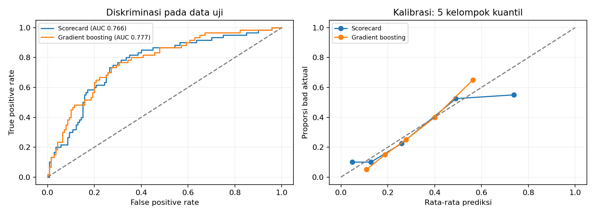

# Laporan Credit Risk Scorecard

Saya membangun scorecard yang dapat direproduksi dan membandingkannya dengan gradient boosting.
Seluruh angka bersumber dari eksekusi `python -m src.pipeline`, terutama `reports/hasil.json`.

## Data dan kualitas

Saya memakai 1000 baris UCI, 300 label bad, 800 latih dan 200 uji.
Sel kosong = 0; duplikasi persis = 0.
Saya mempertahankan duplikasi karena tidak ada ID untuk memastikan peminjam yang sama.
Kamus dan sumber: [docs/data_dictionary.md](../docs/data_dictionary.md), hash di `source.json`.

## Metode dan keputusan

Saya membagi 80:20 secara stratified dengan seed 2024 sebelum transformasi. Saya memakai
empat bin kuantil numerik, kategori asli untuk atribut kategorik, smoothing 0,5 per kelas/bin,
dan WoE = ln(distribusi good/distribusi bad). Saya memilih IV >= 0,02 pada data latih;
ambang ini merupakan aturan eksploratif, bukan jaminan stabilitas. Bila tak ada yang lolos,
fit memilih satu IV tertinggi. Median, bin, WoE, dan seleksi IV dipelajari ulang di setiap
fold latih pada 5-fold stratified CV. Boosting memakai imputasi dan one-hot yang juga
di-fit ulang per fold. Hyperparameter ditetapkan sebelum evaluasi uji.

Saya mengestimasi logistik bad=1 melalui GLM Binomial statsmodels tanpa regularisasi.
Koefisien positif menaikkan log-odds bad per satu unit WoE dengan atribut lain tetap.
P-value dan interval Wald bersifat eksploratif setelah seleksi IV, bukan inferensi konfirmatori.
Konvergensi diwajibkan oleh pipeline; separation atau kegagalan fit menghentikan pipeline,
bukan disembunyikan dengan estimator pengganti. Korelasi antaratribut dan ukuran data
membatasi interpretasi individual.

Saya menetapkan faktor = 20/ln(2) dan offset = 600 - faktor*ln(50).
Skor = offset - faktor*logit(p_bad), sehingga p_bad = 1/(1+exp((skor-offset)/faktor)).
Skor 600 berarti odds good:bad 50:1. Kenaikan 20 poin menggandakan odds good:bad.
Base points = offset - faktor*intersep; poin tiap bin = -faktor*koefisien*WoE.
Kategori baru mendapat WoE 0 dan kontribusi poin 0; base points tetap ditambahkan.
Saya memverifikasi penjumlahan poin terhadap probabilitas tanpa pembulatan. Pembulatan
poin hanya boleh untuk tampilan, bukan pengambilan keputusan.

Saya menolak bila p_bad >= cutoff. Salah setuju adalah bad yang disetujui (false negative)
dengan biaya 5; salah tolak adalah good yang ditolak (false positive) dengan biaya 1.
Cutoff dipilih dari prediksi out-of-fold data latih untuk meminimumkan 5*FN+FP;
bila seri saya memilih tingkat persetujuan tertinggi. Evaluasi data uji dilakukan setelah
keputusan ini dibekukan. Tabel cutoff lain hanya sensitivitas, tidak dipakai memilih ulang.
CV ini mengevaluasi prosedur belajar, sementara ketidakpastian pemilihan cutoff belum
diukur lewat nested CV. Biaya adalah unit relatif, bukan nominal uang atau estimasi laba.

## Hasil

| Metrik uji | Scorecard | Gradient boosting |
|---|---:|---:|
| AUC | 0.765595 | 0.777262 |
| Gini | 0.531190 | 0.554524 |
| KS | 0.471429 | 0.461905 |
| Brier | 0.174752 | 0.169507 |

Saya memperoleh cutoff OOF 0.164670. Pada 200 baris uji,
biaya relatif = 114, salah setuju = 8, salah tolak = 74,
dan tingkat persetujuan = 37.00%. PSI probabilitas latih versus uji =
0.083543. AUC OOF scorecard = 0.774978,
boosting = 0.762827. Base points = 511.953755.
Error maksimum konsistensi poin = 1.14e-13.

## IV dan alasan pemilihan

| attribute           |         iv | selected   |
|:--------------------|-----------:|:-----------|
| checking            | 0.602257   | True       |
| history             | 0.284611   | True       |
| purpose             | 0.191645   | True       |
| savings             | 0.190332   | True       |
| duration            | 0.160005   | True       |
| amount              | 0.146464   | True       |
| age                 | 0.119345   | True       |
| employment          | 0.101306   | True       |
| personal_status_sex | 0.0925594  | True       |
| property            | 0.0811803  | True       |
| housing             | 0.0809159  | True       |
| other_plans         | 0.0576279  | True       |
| debtors             | 0.028067   | True       |
| existing_credits    | 0.0193154  | False      |
| foreign_worker      | 0.0193154  | False      |
| installment         | 0.0159692  | False      |
| job                 | 0.0146226  | False      |
| telephone           | 0.00928489 | False      |
| residence           | 0.00386722 | False      |
| dependents          | 0          | False      |

## Koefisien dan ketidakpastian

|                     |   coefficient |     p_value |   ci_low |    ci_high |
|:--------------------|--------------:|------------:|---------:|-----------:|
| const               |     -0.860573 | 6.16954e-20 | -1.04509 | -0.67606   |
| checking            |     -0.826219 | 2.59948e-11 | -1.06909 | -0.58335   |
| duration            |     -0.853011 | 0.000454197 | -1.32982 | -0.376207  |
| history             |     -0.645957 | 0.000378827 | -1.00215 | -0.289765  |
| purpose             |     -1.00083  | 4.47993e-06 | -1.4284  | -0.57326   |
| amount              |     -0.942388 | 0.00013808  | -1.42698 | -0.4578    |
| savings             |     -0.812413 | 0.000362386 | -1.25893 | -0.365898  |
| employment          |     -0.626018 | 0.0359521   | -1.211   | -0.0410403 |
| personal_status_sex |     -0.934184 | 0.00289211  | -1.54881 | -0.319555  |
| debtors             |     -1.32747  | 0.0136809   | -2.38273 | -0.272205  |
| property            |     -0.317503 | 0.390722    | -1.04253 |  0.407522  |
| age                 |     -0.654145 | 0.0200466   | -1.20547 | -0.102816  |
| other_plans         |     -0.903614 | 0.0166617   | -1.64337 | -0.163854  |
| housing             |     -0.565271 | 0.0987571   | -1.23636 |  0.10582   |

Konvergen: True. Peringatan fit: tidak ada.
Tabel poin lengkap: `scorecard_points.csv`; tabel bin dan distribusi: `woe.csv`.

## Sensitivitas cutoff dan confusion matrix

|   cutoff |   cost |   wrong_approve |   wrong_reject |   tn |   fp |   fn |   tp |   approval_rate |
|---------:|-------:|----------------:|---------------:|-----:|-----:|-----:|-----:|----------------:|
|  0.1     |    121 |               5 |             96 |   44 |   96 |    5 |   55 |           0.245 |
|  0.16467 |    114 |               8 |             74 |   66 |   74 |    8 |   52 |           0.37  |
|  0.2     |    107 |               9 |             62 |   78 |   62 |    9 |   51 |           0.435 |
|  0.3     |    114 |              14 |             44 |   96 |   44 |   14 |   46 |           0.55  |
|  0.5     |    149 |              25 |             24 |  116 |   24 |   25 |   35 |           0.705 |

TN = jumlah good uji - salah tolak; TP = jumlah bad uji - salah setuju.
Seluruh label dan prediksi tersedia pada `test_predictions.csv` untuk rekonstruksi.

## Fairness dan monitoring

| attribute   | group   |   n |   bad_n |   approval_rate |   approval_ci_low |   approval_ci_high |   false_reject_rate_good |   false_approve_rate_bad |    brier |
|:------------|:--------|----:|--------:|----------------:|------------------:|-------------------:|-------------------------:|-------------------------:|---------:|
| age         | 25-49   | 145 |      43 |        0.37931  |          0.304411 |           0.46044  |                 0.509804 |                 0.116279 | 0.156729 |
| age         | 50+     |  23 |       7 |        0.478261 |          0.292369 |           0.670376 |                 0.4375   |                 0.285714 | 0.195204 |
| age         | <25     |  32 |      10 |        0.25     |          0.132522 |           0.421069 |                 0.681818 |                 0.1      | 0.241716 |
| sex         | female  |  64 |      15 |        0.296875 |          0.19905  |           0.417704 |                 0.612245 |                 0        | 0.147147 |
| sex         | male    | 136 |      45 |        0.404412 |          0.325652 |           0.488424 |                 0.483516 |                 0.177778 | 0.187742 |

## Keterbatasan

Saya menggunakan data kredit historis Jerman berukuran kecil. Label good/bad adalah
penilaian kredit sumber dan tidak mendefinisikan horizon default operasional. Hasil split
tunggal dapat berubah pada seed lain. Saya tidak menyimpulkan hubungan sebab akibat.
PSI memakai bin desil dari latih dan floor proporsi 1e-6; split acak bukan bukti pergeseran
populasi antarwaktu. Monitoring operasional memerlukan periode baru serta label yang matang.

Saya memetakan A91/A93/A94 ke male dan A92/A95 ke female sesuai kamus sumber.
Personal status/sex adalah atribut gabungan, bukan pengukuran gender modern atau lengkap.
Saya mempertahankan atribut ini untuk audit demonstrasi dan mengakui pemakaiannya dalam
model dapat memengaruhi keputusan. Kelompok umur ditetapkan <25, 25-49, dan 50+ sebelum
melihat hasil. Tabel fairness memuat ukuran, jumlah bad, approval dengan interval Wilson 95%,
false reject pada good, false approve pada bad, serta Brier. Kelompok kecil menghasilkan
ketidakpastian besar; perbedaan bukan bukti diskriminasi kausal atau jaminan keadilan.
Saya tidak membuat klaim kepatuhan. Aplikasi adalah demonstrasi pendidikan dan bukan
alat persetujuan kredit operasional.

